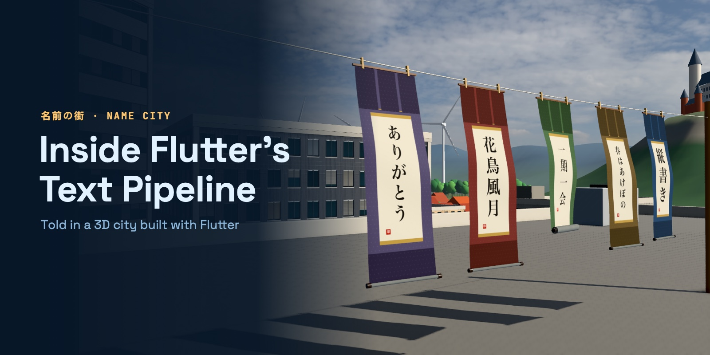
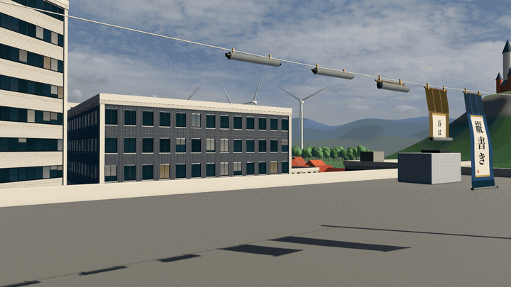
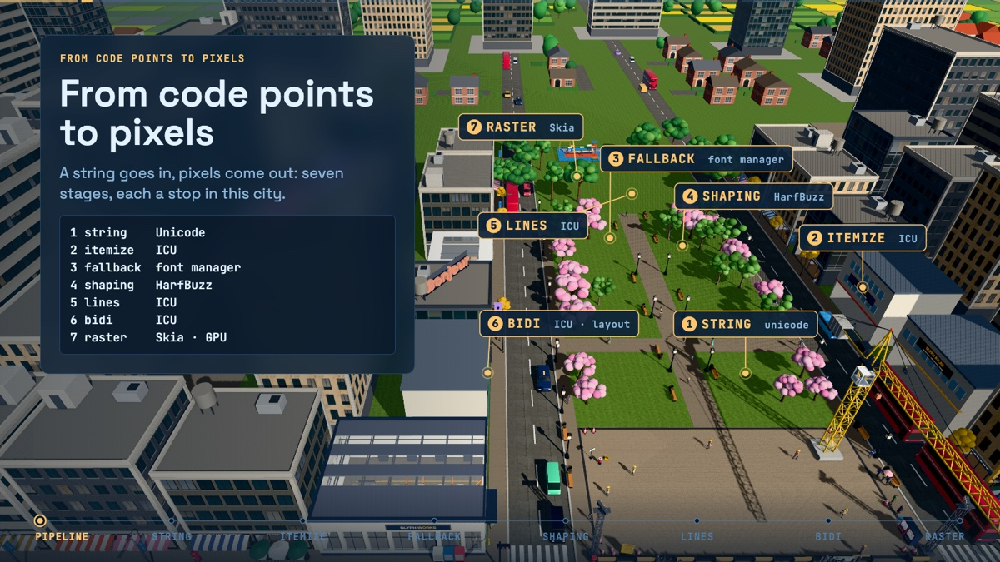
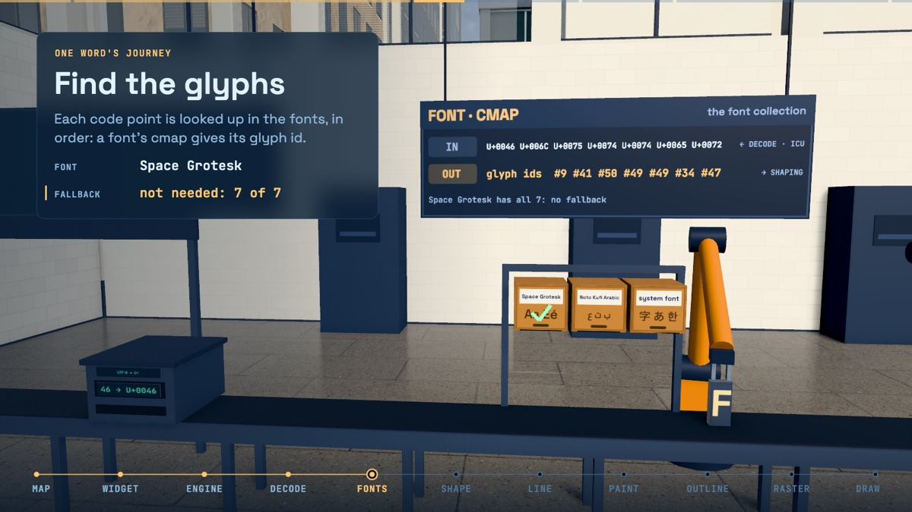
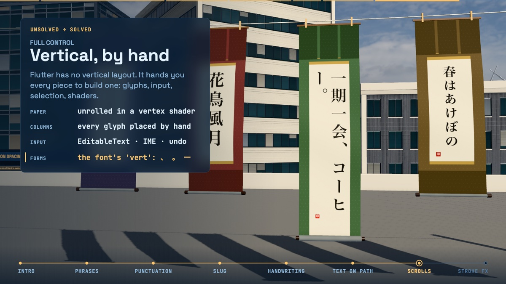
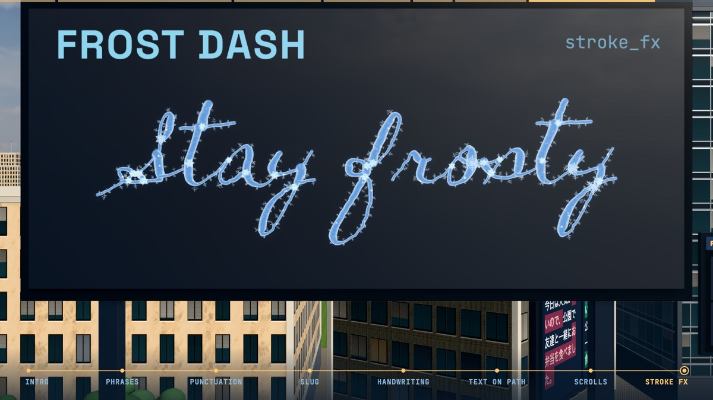

The talk *Inside Flutter's Text Pipeline* as a 3D city built with Flutter. Every stop is a place.



| | |
|:---:|:---:|
|  |  |
|  |  |

## Run it

```sh
cd booth3d && flutter run -d macos --release --dart-define=NAME_CITY_TALK=1
```

**→** next · **←** back · **0–6** section · **B** blank · **F6** presentation

Or in the browser, with lighter graphics: [rahiche.github.io/text-rendering-3d-slides](https://rahiche.github.io/text-rendering-3d-slides/)

<sub>Built with [flutter_scene](https://pub.dev/packages/flutter_scene) (patched for the web: [PATCHED.md](packages/flutter_scene/PATCHED.md)) · features [fountain_pen](https://pub.dev/packages/fountain_pen), [text_on_path](https://pub.dev/packages/text_on_path), [stroke_fx](https://pub.dev/packages/stroke_fx) · the 2D deck: [text-rendering-slides](https://github.com/Rahiche/text-rendering-slides) · credits: `booth3d/assets/*/CREDITS.md`</sub>
